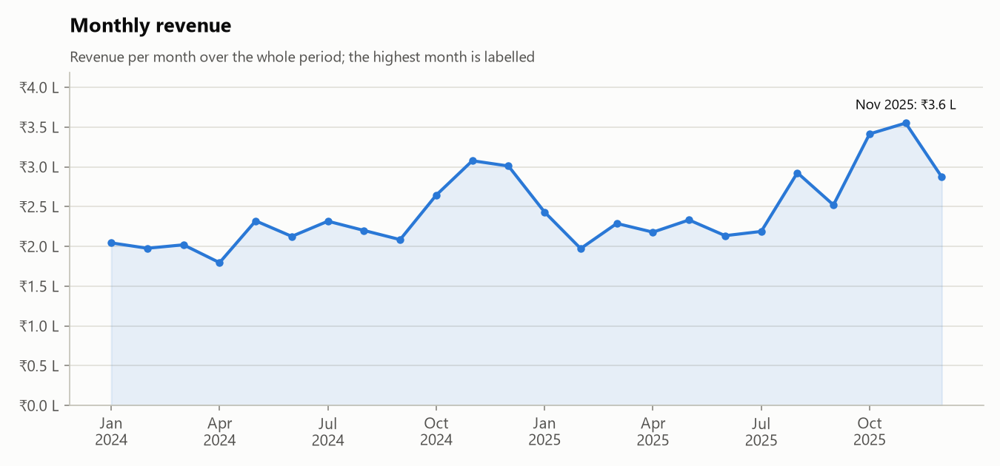
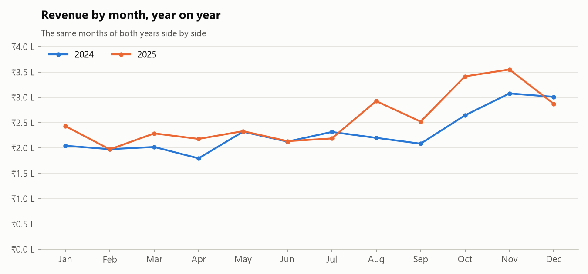
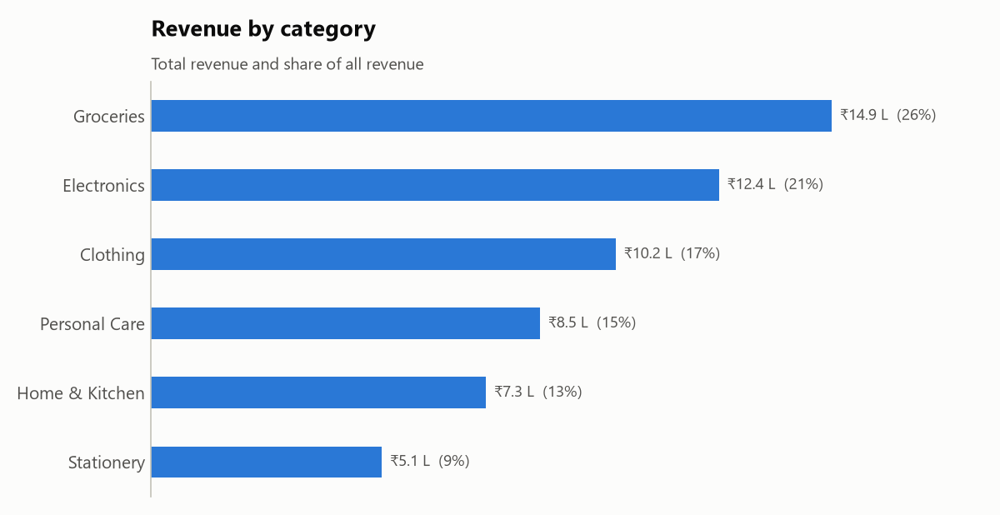
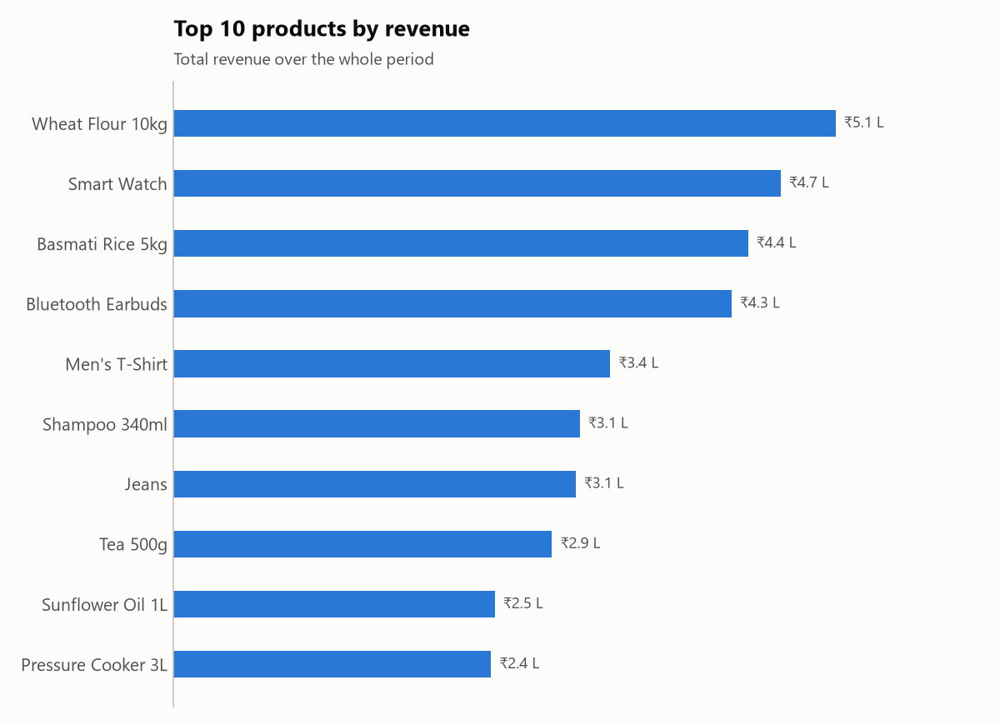
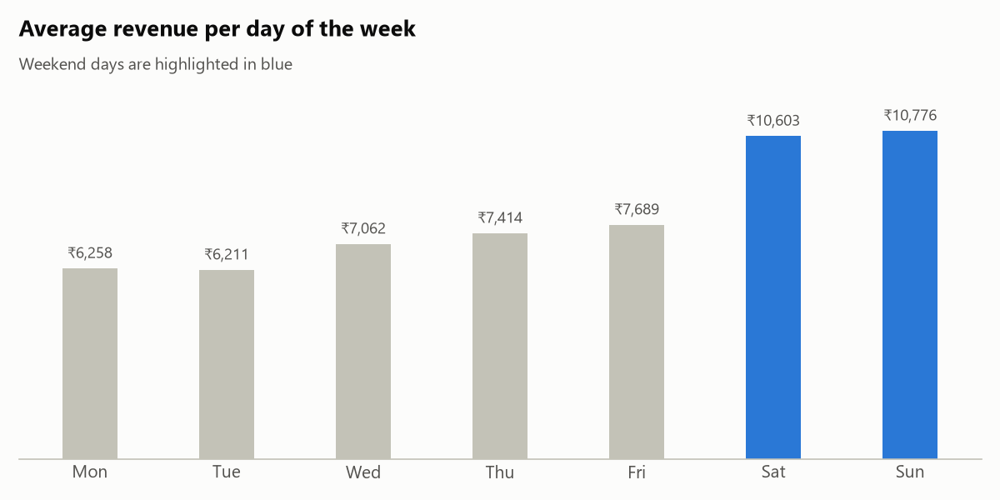
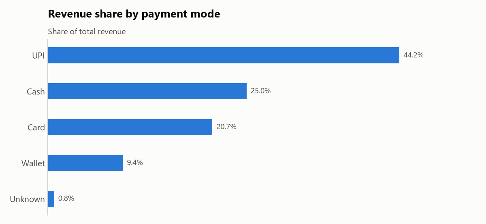
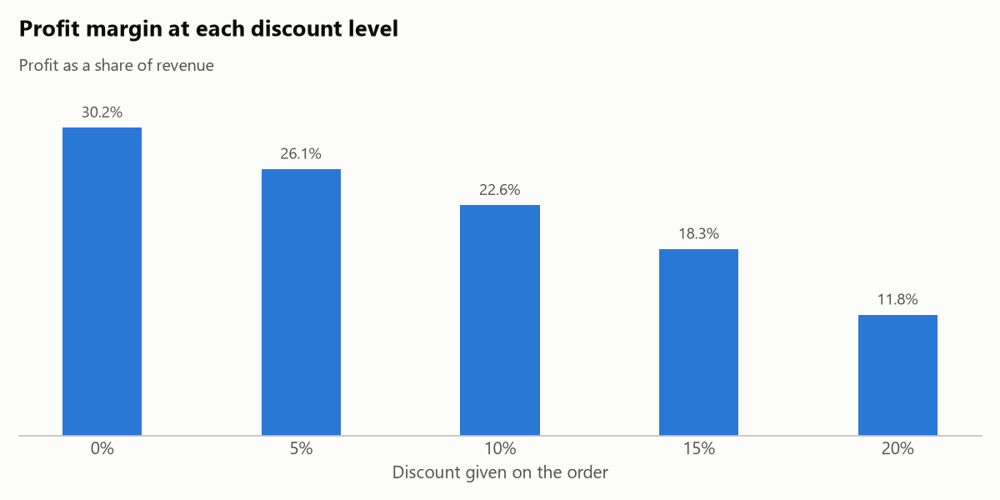

# Sales Data Analysis of a Commercial Store

An analysis of two years of sales data from a retail store, done in Python with **Pandas** for data cleaning and aggregation and **Matplotlib** for the charts. The goal is to turn a raw sales export into answers a store owner can act on: when the store sells most, which categories and products earn the money, and what discounts cost.

> **About the data:** `data/sales_data.csv` is a simulated dataset created by [`generate_data.py`](generate_data.py), not data from a real shop. It is built to behave like real store data (busier weekends, a festive-season peak, missing values and duplicate rows). The numbers below therefore show the method, not facts about a real business.

## Dataset

6,223 rows, one per order, from January 2024 to December 2025.

| Column | Meaning |
| --- | --- |
| `order_id` | Order number |
| `order_date` | Date of the sale |
| `product`, `category` | What was sold (24 products in 6 categories) |
| `unit_price`, `cost_price` | Selling price and purchase cost of one unit (Rs.) |
| `quantity` | Units sold |
| `discount_pct` | Discount given on the order (0, 5, 10, 15 or 20%) |
| `payment_mode` | UPI, Cash, Card or Wallet |
| `customer_type` | New or Returning |

## Steps

1. **Cleaning** – removed 40 duplicate rows, dropped 30 rows with no quantity (the sale amount cannot be calculated without it), and filled 61 missing payment modes with "Unknown". 6,153 rows remained.
2. **Feature engineering** – calculated `revenue` (price × quantity − discount), `cost`, `profit`, and split the date into year, month and weekday.
3. **Analysis** – grouped the data by month, year, category, product, weekday, payment mode, discount level and customer type.
4. **Visualisation** – seven charts saved to `charts/`, plus a text report in `output/summary.txt`.

## Key numbers

| Metric | Value |
| --- | --- |
| Total revenue | Rs. 58.4 lakh |
| Total profit | Rs. 15.4 lakh |
| Profit margin | 26.4% |
| Orders | 6,153 |
| Units sold | 15,651 |
| Average order value | Rs. 950 |

## Findings

**1. Revenue grew 11.6% in the second year**, from Rs. 27.6 lakh in 2024 to Rs. 30.8 lakh in 2025. The best month was November 2025 (Rs. 3.6 lakh) and the weakest April 2024 (Rs. 1.8 lakh).



**2. October and November are the peak season.** These two months bring 21.7% of all revenue; with even sales they would bring 16.7%. Stock and staffing should be planned for this period.



**3. Groceries sell the most but earn the least per rupee.** Groceries are 25.5% of revenue with a margin of only 13.4%, while Clothing has the highest margin at 39.9%. Clothing earns about twice the profit of Groceries (Rs. 4.1 lakh against Rs. 2.0 lakh) from two-thirds of the revenue.



**4. A few products carry a large share of sales.** The top three products (Wheat Flour 10kg, Smart Watch, Basmati Rice 5kg) bring 24.3% of revenue, so these must never be out of stock.



**5. Weekends are 54% stronger than working days.** An average Saturday or Sunday earns Rs. 10,689 against Rs. 6,927 on a working day.



**6. UPI is the main payment mode**, with 44.2% of revenue.



**7. Discounts cut the margin sharply without increasing the quantity bought.** The margin falls from 30.2% with no discount to 11.8% at a 20% discount, while the average quantity per order stays at about 2.5 units at every discount level. In this data, large discounts give away profit without selling more per order.



**8. Returning customers place 60.5% of the orders.**

## How to run

Requires Python 3.10 or newer.

```
pip install -r requirements.txt
python analysis.py
```

This prints the report and rewrites `charts/` and `output/summary.txt`. To rebuild the dataset first, run `python generate_data.py` (it uses a fixed random seed, so the result is always the same).

## Project structure

```
├── analysis.py          Cleaning, analysis, report and charts
├── generate_data.py     Creates the simulated dataset
├── data/sales_data.csv  The dataset
├── charts/              The seven charts shown above
├── output/summary.txt   Full text report with the detailed tables
└── requirements.txt     Python libraries used
```
